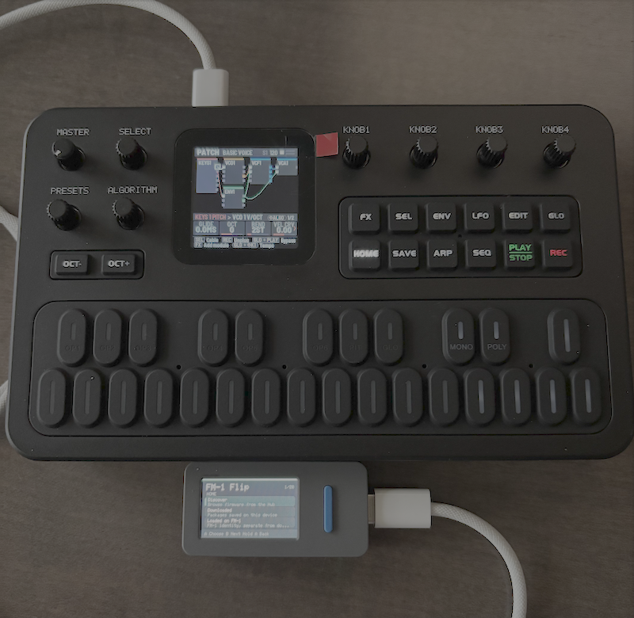

# FM-1 Flip

A portable M-VAVE FM-1 firmware manager for **M5Stack StickS3, Cardputer ADV, and original Cardputer**. Browse firmware, download packages, install them on an FM-1, and optionally save backups without a computer. A local web interface is also available.



## Choose your board

Download precompiled binaries from [GitHub Releases](https://github.com/chrisdiana/fm1-flip/releases).

| Board | Guide | Binary |
| --- | --- | --- |
| Cardputer / Cardputer ADV | [Installation, keyboard controls and SD imports](docs/CARDPUTER.md) | `fm1-flip-cardputer.bin` |
| StickS3 | [Installation, button controls and text entry](docs/STICKS3.md) | `fm1-flip-sticks3.bin` |

Both merged binaries support current M5Launcher or standalone flashing at **`0x0`**. Standalone flashing replaces Launcher and its partition layout/settings. Cardputer uses a FAT32 microSD card; StickS3 uses internal storage. See [M5Launcher installation and packaging](docs/M5LAUNCHER.md) for details.

## Using FM-1 Flip

Start with your board guide above, then see the [shared usage guide](docs/USAGE.md) for:

- [Home menu, browsing, downloads and installation](docs/USAGE.md#home-and-everyday-use)
- [Optional backups and restore](docs/USAGE.md#optional-backups-and-restore)
- [Browser access and the optional web interface](docs/USAGE.md#optional-web-interface)
- [Wi-Fi power controls and diagnostics](docs/USAGE.md#wi-fi-and-download-diagnostics)
- [Troubleshooting](docs/USAGE.md#troubleshooting)

Valid local FM-1 `.fwsc` packages can be installed without a Hub listing or JSON sidecar. Installation requires physical confirmation; package validation and known chip mismatch checks remain enforced. Backups are optional. See the [Cardputer SD import instructions](docs/CARDPUTER.md#copy-downloaded-firmware-to-cardputers-sd-card) or import through the web interface on StickS3.

## Build and checks

Install PlatformIO, then run from this directory. The first build downloads ESP-IDF and rebuilds the SDK through pioarduino HybridCompile so composite USB descriptors larger than the stock 256-byte limit can enumerate; allow additional build time and disk space:

```sh
pio run -e cardputer -e sticks3
python3 tools/check.py
# Optional real-browser frontend check with a local fixture API:
python3 tools/check_web.py
python3 tools/package_launcher.py
```

On this host, the PlatformIO executable is `~/.platformio/penv/bin/pio` if `pio` is not on PATH.

Pinned dependencies and partition layouts are in `platformio.ini` and `partitions/`. The same two merged release binaries and SHA-256 manifest are generated in `build/releases/`; both images are merged for offset `0x0`. App-only `.pio/build/<board>/firmware.bin` images belong at the application partition offset `0x10000`. No command above uploads to hardware. USB download-mode and M5Launcher installation must be checked on the actual board before use.

The StickS3 uses a single 3 MiB application partition and a 4.9375 MiB LittleFS partition, with no OTA app slot. Packages share that filesystem with catalogue data and backups. Cardputer stores these files on a FAT32 microSD card. Imports leave 64 KiB of working space. Firmware installs do not automatically create or require a backup. Choose **Create backup** on Home to retain a verified 1 MiB image when wanted; existing backups remain stored and consume actual space. Backup restoration still creates its fresh rollback backup. Full storage causes operations to refuse or fail rather than deleting saved backups.

## Project records

- [Implementation status and evidence](docs/IMPLEMENTATION-STATUS.md)
- [Hardware validation procedure](docs/HARDWARE-VALIDATION.md)
- [Package format and real release checks](docs/package-format.md)
- [Firmware Hub access, attribution and cache policy](docs/firmware-hub.md)
- [Dependencies and upstream provenance](docs/DEPENDENCIES.md)

Project code is GPL-3.0-only; imported MIT and other third-party components retain their licenses. See `LICENSE` and `third_party/cardputer-synth-rescue/THIRD-PARTY.md`. Firmware list: [The Firmware Hub](https://thefirmwarehub.com/), CC BY 4.0 compilation; maker descriptions/images remain their makers' work. The local catalogue normalizes and bounds metadata for embedded use, and links to the maker sources.
